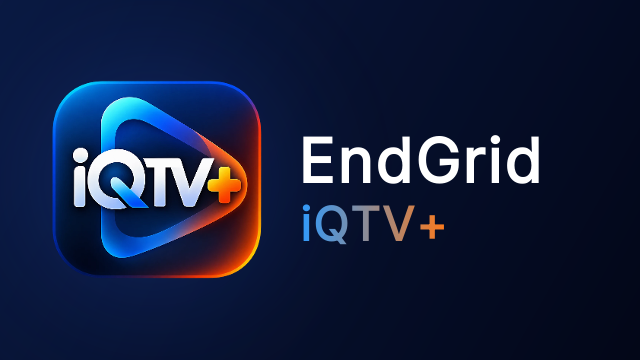
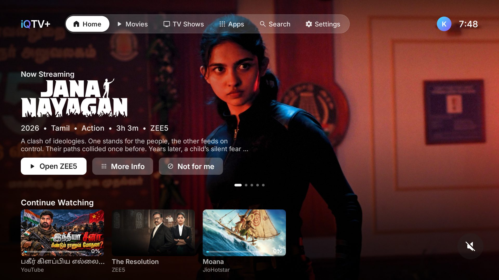
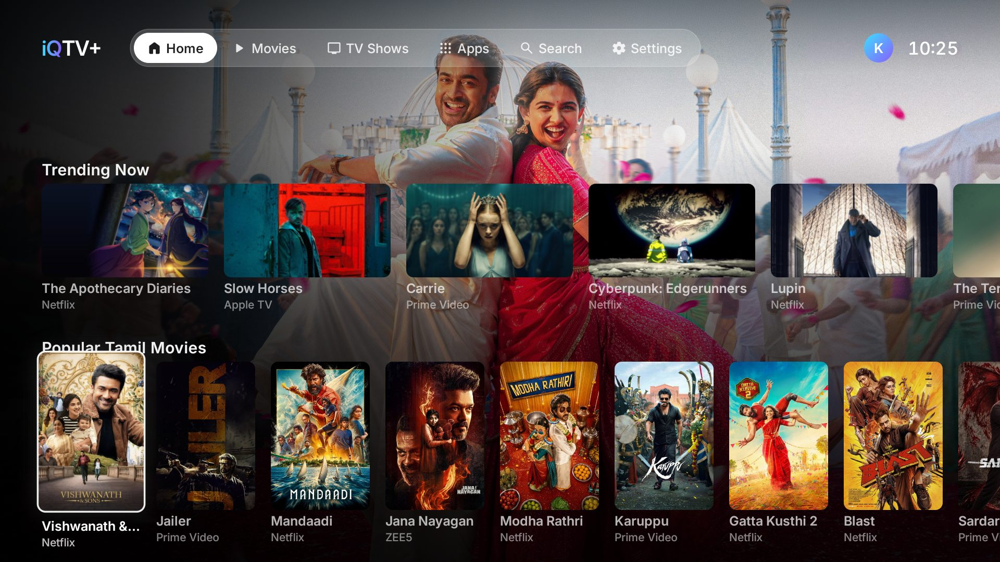
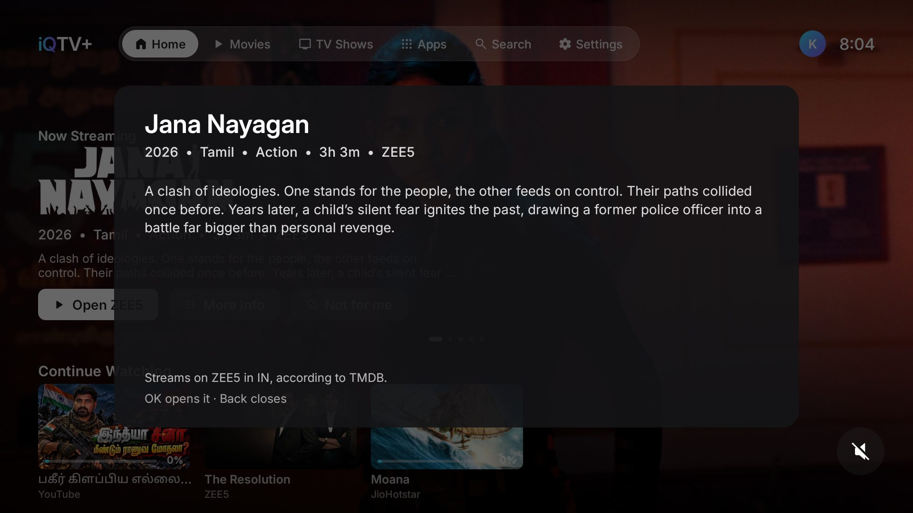
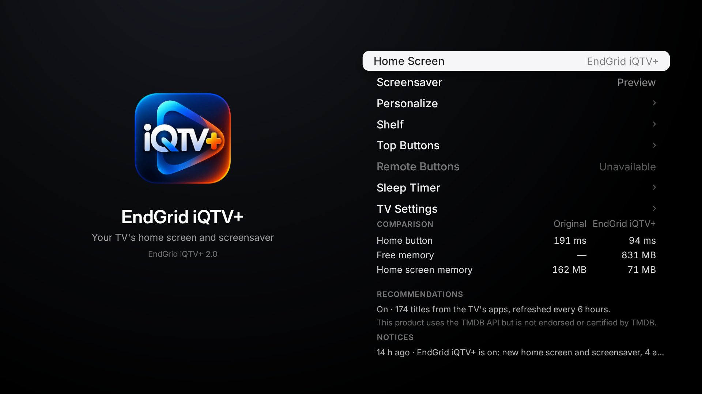

<div align="center">



# EndGrid iQTV+

**A cinematic, ad-free home screen for Google TV and Android TV, by [EndGrid Labs](https://endgrid.in).**

The title you're about to watch fills the screen. Your apps, what you were watching and what's new in your languages
sit right under it. Open source, private, and one button to go back to the TV's own home screen.

</div>

| Home | Rows |
|---|---|
|  |  |
| **More Info** | **Settings** |
|  |  |

## What you get

- **A cinematic home screen.** The iQTV+ wordmark, a glass navigation bar (Home, Movies, TV Shows, Apps, Search,
  Settings), your initial and the clock. The featured title fills the screen with its logo art (or name), year,
  language, genre, length and service, a short description, and **Open *app*** (or **Watch Now** when a title link
  exists), **More Info** and **Not for me**. It rotates through your recommendations.
- **Your Apps** right under the featured title, then **Continue Watching** and rows in your languages: Trending Now,
  Popular and Latest movies (posters), TV Shows, Web Series, Recommended for *you*, a row per genre you like,
  Recently Watched and New Releases. Each row on or off, in your order.
- **Only real availability.** A title shows only when TMDB's watch-provider data (from JustWatch) lists it as streaming
  by subscription in your region, on an app installed on the TV. Nothing is shown on a guess.
- **Honest watch history.** Continue Watching (the 10 most recent) and Recently Watched come only from what the
  streaming apps report to Android while they play. Progress is the app's own position. The picture is TMDB's when the
  name matches, else the artwork the app itself showed while it played, else the app's banner. Hold OK on a title to
  take it off the home screen until you play it again.
- **Search** by title, actor, director or year, typed or spoken; each result says where it streams in your region.
- **All Apps** lists every app on the TV; hold OK on one to put it in Your Apps or take it off.
- **A screensaver** with your photos (USB drive, the TV's storage, or sent from a computer) or the titles' artwork,
  with pan and zoom, crossfades, shuffle, interval and start time; the weather and the inputs one press below Your Apps.
- **No ads, no accounts, no tracking.** Everything you set and everything it learns stays on the TV.

## Install

**[Download the latest APK](https://github.com/endgridlabs/iQTV/releases/latest)** for Google TV and Android TV
(Android 8 or newer), install it, and make it the home screen: the step-by-step guide is
**[docs/INSTALL.md](docs/INSTALL.md)** (Downloader app, USB drive or adb). Then paste your free TMDB key in
*Settings › Personalize › Recommendations*.

**LG or Samsung TV?** They don't run Android apps; see **[docs/LG-SAMSUNG.md](docs/LG-SAMSUNG.md)** for the way to
get EndGrid iQTV+ on them with a Google TV streamer.

### Build it yourself

About ten minutes. You need a Google TV or Android TV and a computer on the same Wi-Fi.

1. **On the TV**, turn on developer mode: Settings → System → About → press *Android TV OS build* 7 times. Then
   Settings → System → Developer options → turn on **USB debugging**. Write down the TV's IP address
   (Settings → Network & Internet).
2. **Tools:** a JDK (17+), the Android SDK command-line tools (build-tools 34, platform android-34) and adb. On a Mac:
   ```bash
   brew install --cask temurin android-commandlinetools android-platform-tools
   sdkmanager "build-tools;34.0.0" "platforms;android-34"
   ```
   On Linux, get OpenJDK 17, Android's command-line tools and adb from your package manager, then run the same
   `sdkmanager` line. On Windows, use Git Bash or WSL.
3. **Build:**
   ```bash
   ./build.sh
   ```
   The first run creates `config.properties`. Set your city and your [TMDB key](#the-tmdb-key) there, then run it again.
4. **Install:**
   ```bash
   adb connect 192.168.1.50:5555
   adb install -r iQTV.apk
   ```
   On Android 14, Google Play Protect may hold the install with *Risky app blocked*: choose *More details* →
   *Install anyway*. Updates don't ask again. On TCL TVs, also let it run in the background:
   ```bash
   adb shell "appops set io.freemytv AUTO_START allow || appops set io.freemytv APP_AUTO_START allow"
   ```
5. **On the TV**, open *EndGrid iQTV+* → *Home Screen* → *EndGrid iQTV+*. The TV asks *Allow USB debugging?* for the
   app: tick *Always allow* and accept.

With an AI coding assistant ([Claude Code](https://claude.com/claude-code) or another), you can also say *"Install
EndGrid iQTV+ (github.com/endgridlabs/iQTV) on my TV at 192.168.1.50. I live in Bengaluru."*

## Settings

On the TV: *EndGrid iQTV+* → *Personalize*.

| Page | What you set |
|---|---|
| **Your name** | Your initial at the top, and "Recommended for *name*". |
| **Language & Region** | Content languages, as many as you like, in priority order; country or region. Menu language is in Home Settings. |
| **Streaming Apps** | Which installed services feed the picks and search; your order of preference; which aren't installed; Your Apps. |
| **Recommendations** | Your TMDB key (pasted on the TV); preferred genres; use what I watch; suggest titles I finished; titles hidden with "Not for me"; titles removed from Continue Watching (show them again). |
| **Home Rows** | Each row on or off, and its place (← →). |
| **Screensaver** | Photo source, album, order, interval, motion, start after, preview. |
| **Home Settings** | Menu language, temperature, theme, my photos, navigation sounds, the weather card and its city. |
| **About** | Version, EndGrid Labs (endgrid.in), source code, license, sources, privacy. |
| **Reset preferences** | Everything on these pages back to the defaults. |

The first values come from `config.properties`, created by the first build:

| Key | What it does | Default |
|---|---|---|
| `tmdb_key` | Your free TMDB key, for the picks | empty |
| `tmdb_region` | Your country (two letters): which titles are on which app | `US` |
| `content_language` | Your content languages, comma separated (`ta`, `hi`, `en`…) | empty |
| `viewer_name` | Your name | empty |
| `watchmode_key` | Optional, free [Watchmode](https://api.watchmode.com/) key: a title opens its own page in its app | empty |
| `latitude`, `longitude`, `city` | Your city, for the weather and the sunset | New York |
| `hide_animation` | Leave cartoons and anime out of the picks | `false` |
| `language` | `auto` (follows the TV), or a language with a [translation](#translations) | `auto` |
| `temperature` | `C`, `F` or `auto` | `auto` |
| `disable_assistant` | Also turn off Google Assistant | `false` |
| `hide_services` | Streaming services to leave out of the picks (`netflix`, `prime`…), comma separated | empty |

Changed something? Run `./build.sh` and install again. Keep `iqtv.keystore`: updates are signed with it.

### The TMDB key

Free: create an account at [themoviedb.org](https://www.themoviedb.org/signup), open
[Settings → API](https://www.themoviedb.org/settings/api) and request a developer key. Paste the *API Read Access
Token* (or the *API Key*) after `tmdb_key=`. `config.properties` stays out of git.

### Your own photos (optional)

With the TV connected over adb, send photos or whole folders from your computer:

```bash
python3 tools/photos.py <TV IP> beach.jpg hills.jpg Holidays/
```

The next time the home screen, the screensaver or the settings open, the app imports each one: turned upright, cropped
to 16:9, resized for the TV and saved without its GPS and other tags. Up to 100; JPEG, PNG, WebP, and HEIC on Android 9+.

## Going back

On the TV: *EndGrid iQTV+* → *Home Screen* → *Original*. The factory home screen, screensaver and every app come back
exactly as they were. If the new home screen ever crashes three times in five minutes, it switches back by itself.
To remove it for good, switch to *Original* first, then uninstall *EndGrid iQTV+* (Settings → Apps).

## What it changes

- It becomes the home screen and the screensaver.
- It turns off, without uninstalling, the stock home screen and screensaver, Google TV's recovery home and Play Games,
  and on some brands their promo, demo and tracking apps (`DEBLOAT` in
  [`HomeMode.java`](app/src/io/freemytv/HomeMode.java)). YouTube Music stays on.
- Picture, sound, inputs, remote pairing, Google services and the Play Store are on a protected list, checked before
  every change. Apps that saved a Wi-Fi network are never turned off.
- On Google TV, the Assistant's film and show results come from Google TV's home app, which is off: asking it to play a
  show may not work. Opening apps, questions and apps' own voice search still do; *Original* brings it all back.

## How it works

- **A plain Android app, no Gradle, no libraries.** [`build.sh`](build.sh) runs aapt2 → javac → d8 → zipalign →
  apksigner.
- **It uses the TV's own ADB, from inside the TV**, to become the home screen (`cmd package set-home-activity`), set the
  screensaver and grant itself the watch-history permissions. Nothing listens to the network.
- **Drawn by hand on a Canvas**, layer by layer, with springs for every movement.

| File | Role |
|---|---|
| `HomeView` | The home screen: top bar, hero, rows, Your Apps, More Info, search, remote navigation. |
| `Tokens`, `Brand` | Design values; the EndGrid mark. |
| `Recs` | Titles from TMDB, availability, images, taste, search, Continue Watching. |
| `Providers` | The streaming services and what each can do. **Add a service here.** |
| `Prefs` | Every preference, stored on the TV, with `config.properties` as the defaults. |
| `NowPlaying`, `WatchLog` | What the streaming apps report playing (media sessions), and the artwork they show. |
| `SettingsActivity`, `SettingsPages` | Settings. |
| `DreamView`, `Photos` | The screensaver and its photos. |
| `HomeMode` | Switching home screens through the TV's own ADB. |
| `Lists` | Plain logic (lists, title matching), tested on a computer. |

The Java package is `io.freemytv`: it's the installed app's ID, kept so updates install over the app on your TV.

```bash
./build.sh                  # the APK
tools/test.sh               # the plain-logic tests (JDK only)
java tools/MakeArt.java .   # redraws the icon, the TV banner and a few glyphs
```

## Translations

Each language is one file, [`app/assets/i18n/<lang>.json`](app/assets/i18n), keyed by the English text in the code.
*Automatic* follows the TV's language. `python3 tools/translate.py` lists what each language lacks; with
`ANTHROPIC_API_KEY` set, `--fill` translates only that, and `--check` validates all catalogues.

## Supported, and not

Validated on a OnePlus TV (Android 11). Other Google TV and Android TV devices are expected to work.

| Feature | Status |
|---|---|
| Titles, availability, descriptions, genres | TMDB (free key). Regions and languages as TMDB has them. |
| Open a title's own page | Only with a Watchmode key, and only in apps that open title addresses (tested: Prime Video, JioHotstar). |
| Watch history, progress, artwork | Only from apps that report playback through Android media sessions (tested: ZEE5, JioHotstar, YouTube). |
| The remote's Assistant button | Stays Google's. Search has its own button. |
| Apple Photos, Google Photos | Not reachable from Android TV. Photos come from a USB drive, the TV's storage, or a computer. |

## Credits

- This product uses the TMDB API but is not endorsed or certified by [TMDB](https://www.themoviedb.org/).
- Weather data by [Open-Meteo.com](https://open-meteo.com/) (CC BY 4.0). Title links by [Watchmode](https://api.watchmode.com/).
- Icons: [Material Symbols](https://fonts.google.com/icons) (Apache 2.0). Font: [Inter](https://rsms.me/inter/) (SIL OFL 1.1).
- Not affiliated with Apple, Google or any streaming service. App names and logos belong to their owners.

See [PRIVACY.md](PRIVACY.md) for what is stored and where, and [CONTRIBUTING.md](CONTRIBUTING.md) to help.

## License

[MIT](LICENSE) © EndGrid Labs.
